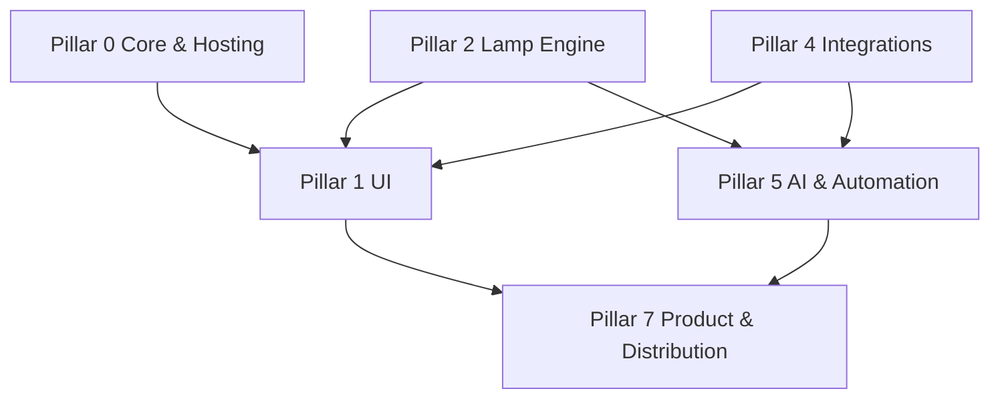

# Master Plan & Pillars Architecture
> **Source of truth for what we're building and why.**
>
> When starting any task, tell the agent: **"Let's work on [Pillar Name]"** (e.g., *"Let's work on Pillar 5: AI & Automation"*).
> The agent reads only that specific pillar file, keeping 100% reasoning focus on that domain while saving tokens.
> Full session history is logged in `docs/PROGRESS_LOG.md`.

**Vision:** the simplest way to control a Quran speaker lamp — from a phone, a PC, or by asking Claude — with azan
always matching your own mosque. Start with Equantu SQ-122, then other models, then sell it.

---
## 🏛️ Active Modular Pillars
| Pillar | Roadmap File | Scope & Domain Responsibility | Trigger Keywords | Status |
| :--- | :--- | :--- | :--- | :---: |
| 0 — Core Architecture & Hosting | `docs/pillars/00_CORE_ARCHITECTURE.md` | App shell, PWA, GitHub Pages, local copy + sync, PC tasks | "Pillar 0", hosting, deploy, sync, PWA | 🟢 live |
| 1 — UI & Design | `docs/pillars/01_UI_DESIGN.md` | Tabs, screens, theming, languages | "Pillar 1", UI, screen, design, Arabic | 🟢 live |
| 2 — Lamp Control Engine | `docs/pillars/02_LAMP_ENGINE.md` | Bluetooth link, commands, replies, lists, models | "Pillar 2", Bluetooth, command, protocol | 🟢 live |
| 4 — Integrations & Platform Limits | `docs/pillars/04_INTEGRATIONS.md` | Mawaqit, Web Bluetooth limits, IR power-on | "Pillar 4", Mawaqit, mosque, IR, iPhone | 🟡 partly |
| 5 — AI & Automation | `docs/pillars/05_AI_AUTOMATION.md` | MCP server for Claude, scheduled recitations, alerts | "Pillar 5", MCP, Claude, schedule, Al-Kahf | 🔵 started |
| 7 — Product & Distribution | `docs/pillars/07_PRODUCT_DISTRIBUTION.md` | Brand, landing page, selling, legal, support | "Pillar 7", sell, price, brand, legal | ⚪ todo |

Skipped: Pillar 3 (no user data yet), Pillar 6 (no accounts/billing yet; revisit in Pillar 7 when selling).

---
## 🔗 Dependency Graph & Build Order

🪜 **Recommended Sequencing List & Rationale**
1. **Pillar 2** — every feature is a lamp command; keep the engine correct and shared (web + MCP).
2. **Pillar 5** — MCP server and schedules reuse the engine and add the most value right now.
3. **Pillar 0** — tests, versioning and a shared engine module before the code grows.
4. **Pillar 1** — Arabic/French UI, polish, onboarding.
5. **Pillar 4** — IR power-on, more mosques, iPhone answer.
6. **Pillar 7** — only after it is stable on 2+ lamp models.

⚠️ **Cross-Cutting Concerns Note**
Features in one pillar that affect another must be cross-referenced in both pillar files.
The command table in Pillar 2 is shared by the web app (`index.html`) and the MCP server (`mcp/`): change both together.
